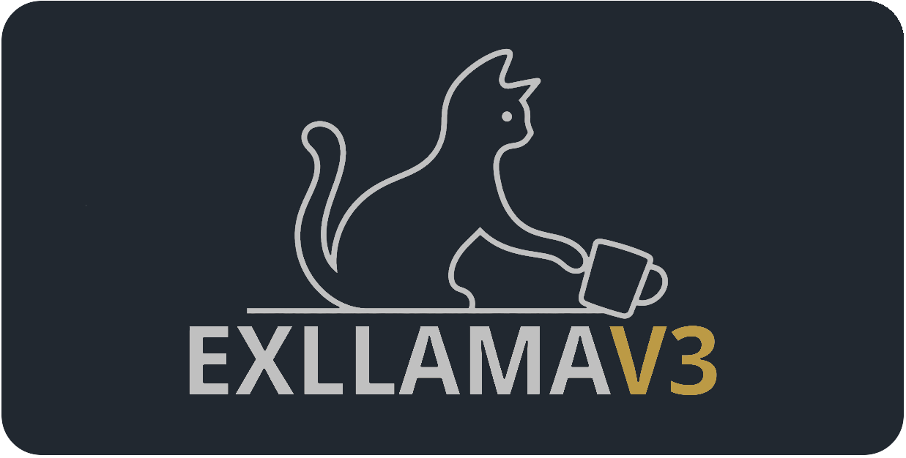
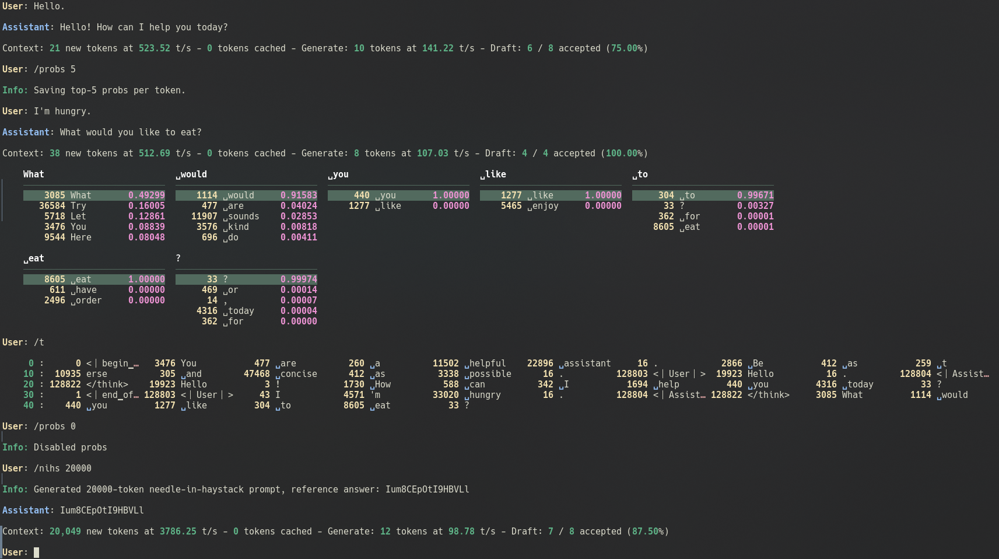

<p align="center">
  
</p>

[Installation](#installation) · [Supported models](#architecture-support) · [Examples](#examples) · [Quantization](#exl3-quantization) · [KV cache streaming](#kv-cache-streaming) · [Vision offloading](#vision-encoder-offloading) · [Community](#community)

ExLlamaV3 is an inference library for running local LLMs on modern consumer GPUs, with flexible quantization and parallel inference.

- **Quantization** - [EXL3](#exl3-quantization), based on QTIP, plus 2–8 bit cache quantization.
- **Parallel inference** - Flexible tensor-parallel and expert-parallel inference for consumer hardware setups.
- **CPU offloading** - Allows large MoE models to run with limited GPU resources. AVX2 and AVX512 support.  
- **[Vision offloading](#vision-encoder-offloading)** - Runs the Qwen 3.5 vision encoder on CPU/system RAM, or pins its weights in host memory, freeing VRAM for the language model.
- **[KV cache streaming](#kv-cache-streaming)** - Keeps long-context KV history in pinned host RAM and streams it through a small shared GPU ring, extending context beyond VRAM.
- **Generation** - Continuous, dynamic batching, speculative decoding, multimodal support.
- **Integrations** - Broad [HF model support](#architecture-support), a [Transformers plugin](examples/transformers_integration.py), and an OpenAI-compatible API via [TabbyAPI](https://github.com/theroyallab/tabbyAPI/).

> [!TIP]
> **Looking for a server?** [TabbyAPI](https://github.com/theroyallab/tabbyAPI/) is the official and recommended backend server. It provides an OpenAI-compatible API for local or remote inference, HF model downloading, embedding model support, and HF Jinja2 chat templates. Its startup script manages and installs prerequisites to help you get started.

<p align="center">
  
</p>

## Installation

Start by making sure you have the appropriate version of [PyTorch](https://pytorch.org/get-started/locally/) installed (CUDA 12.4 or later) since the Torch dependency is not automatically handled by `pip`. Then pick a method below:

### Prebuilt wheel · recommended

Pick a wheel from the [releases page](https://github.com/turboderp-org/exllamav3/releases), then e.g.:

```sh
pip install https://github.com/turboderp-org/exllamav3/releases/download/v0.0.6/exllamav3-0.0.6+cu128.torch2.8.0-cp313-cp313-linux_x86_64.whl
```

### Install from PyPI

```sh
pip install exllamav3
```
Note that the PyPI package does not contain a prebuilt extension and requires the CUDA toolkit and build prerequisites (i.e. VS Build Tools on Windows, gcc on Linux, `python-dev` headers etc.).

### Build from source

<details>
<summary>Source installation with uv or pip</summary>


`exllamav3` declares a minimum `torch` version (>= 2.6.0) and CUDA version (>= 12.4), but beyond that the user is free to select a version of `torch` that is compatible with their environment.

`torch` can be installed in three ways (from least to most effort):
1. **with `uv`, setting only `--extra cuXXX`** installs `torch` automatically with the specified CUDA version, `torch` version is selected by `uv` from compatible versions in the specific index associated with the chosen CUDA version (options 1 and 2)
2. **with `uv`, creating a thin project that depends on `exllamav3[cuXXX]` and pins a specific `torch` version** — like (1) but `torch` is pinned in the thin project's `pyproject.toml`, see [pinning a specific PyTorch version (optional)](#pinning-a-specific-pytorch-version-optional) for details
3. Manually with `uv pip` or `pip` (options 3 and 4)

The flavor extras (`--extra`) are `cu124`, `cu126`, `cu128`, `cu129`, `cu130`, and `cu132` — pick the one matching your installed CUDA build. Both `uv sync` and `pip install .` build the package in an isolated environment where your `torch` is not visible, so they install the extension sources and compile them at first import (JIT, a few minutes once per torch version). For a precompiled install run `pip install --no-build-isolation .` in an environment that already has `torch`, or use the release wheels. Selecting a flavor installs the matching CUDA build of `torch`.

**Option 1 — Working in the cloned repo directly (`uv sync`):**

```sh
git clone https://github.com/turboderp-org/exllamav3
cd exllamav3
# (Optional) switch to dev branch for latest in-progress features
git checkout dev

uv venv
uv sync --extra cu130
# add --extra examples and/or --extra eval for those extra dependencies
```

**Option 2 — Using `exllamav3` as a dependency from another project (`uv add`):**

```sh
# `uv add` works inside an existing project (a directory with a pyproject.toml).
# `uv init` creates one if you're starting a new project, if integrating into
# an existing project skip `uv init`.
uv init my-project
cd my-project

# local checkout
uv add 'path/to/exllamav3[cu130]'               # non-editable
uv add 'path/to/exllamav3[cu130]' --editable    # editable

# straight from GitHub
uv add 'git+https://github.com/turboderp-org/exllamav3.git[cu130]'                 # default branch
uv add 'git+https://github.com/turboderp-org/exllamav3.git[cu130]' --branch dev    # specific branch
```

**Option 3 — Bring your own `torch` and let `uv` pick the backend automatically:**

```sh
uv venv            # or: uv venv --python-preference only-managed
source .venv/bin/activate
uv pip install torch --torch-backend=auto
uv pip install .
```

`--torch-backend=auto` inspects your system and installs the matching PyTorch CUDA build; see [Automatic backend selection](https://docs.astral.sh/uv/guides/integration/pytorch/#automatic-backend-selection).

**Option 4 — With `pip`:**

On Windows, you also need the `triton-windows` package (declared as a dependency in `pyproject.toml`); the attention, cache and recurrent kernels are Triton and ExLlamaV3 does not import without it.

```sh
# install a CUDA-enabled torch first so it matches your setup, e.g.:
pip install torch --index-url https://download.pytorch.org/whl/cu128
pip install .
```

</details>

<details>
<summary>Pinning a specific PyTorch version (optional)</summary>

#### Pinning a specific PyTorch version (optional)

The flavor extra picks the *index*, but by default torch resolves to the latest version on that
index that satisfies `>=2.6.0`. To pin a specific torch version while developing on `exllamav3`,
create a **"thin" project** that consumes your local checkout as an editable install and declares
the exact `torch` version itself. This keeps the pin out of the `exllamav3` pyproject, so
you can change the torch version freely without touching the repo.

```
my-exllamav3-dev/          # thin project (uv init)
├── pyproject.toml
└── src/                  # package sources (auto-generated)
```

In `pyproject.toml`:

```toml
[project]
name = "my-exllamav3-dev"
version = "0.1.0"
description = "Dev environment for exllamav3"
requires-python = ">=3.10.11"
dependencies = [
    "exllamav3[cu130]",   # select correct CUDA version
    "torch==2.13.0",      # pin the exact torch version you need
]

[tool.uv.sources]
exllamav3 = { path = "../exllamav3", editable = true }
```

Adjust `../exllamav3` to point at your local checkout, then a plain `uv sync` sets up an
environment with the correct PyTorch index (routed via the `cuXXX` extra),
the pinned version of `torch` from that index (as long as it exists), and an editable install of `exllamav3` so code
changes apply immediately. Switch CUDA flavors by changing the extra (`exllamav3[cu124]`,
`exllamav3[cu128]`, …) and/or the torch pin in the thin project.

Or, if you're installing torch manually with `uv pip install torch` (e.g. as in Option 3 above),
specify the version directly, e.g. `uv pip install "torch==2.11.0" --torch-backend=auto`.

</details>

After installing with one of the options above, you should be able to run the conversion, eval and 
example scripts from the main repo directory, e.g., `uv run python convert.py -i ...` or, for manual
installations once the venv is active, `python convert.py -i ...`

**Build environment variables**

- `MAX_JOBS`: by default ninja may launch too many processes and run out of system memory for 
compilation. Set this to a reasonable value like 4 in that case.
- `EXLLAMA_NOCOMPILE`: set to install the library without compiling the C++/CUDA extension. Torch
will build/load it at runtime instead.
- `EXLLAMA_EXT_LINEINFO`, `EXLLAMA_EXT_COMPRESS`: see [doc/env_vars.md](doc/env_vars.md).

## Examples

A number of example scripts are provided to showcase the features of the backend and generator. 
For instance, a versatile CLI chatbot:

<p align="center">
  
</p>

```sh
python examples/chat.py -m <input_dir> -mode <prompt_mode>

# Wealth of options
python examples/chat.py -h
```

## Architecture support

| Model family                                     | HF architecture | Multimodal | Notes |
|--------------------------------------------------| --- | :---: | --- |
| **AFM**                                          | `ArceeForCausalLM` |  |  |
| **AfMoE**                                        | `AfmoeForCausalLM` |  |  |
| **Apertus**                                      | `ApertursForCausalLM` |  |  |
| **Command-R** etc.                               | `CohereForCausalLM` |  |  |
| **Command-A**, **Command-R+** etc.               | `Cohere2ForCausalLM` |  |  |
| **DeciLM**, **Nemotron**                         | `DeciLMForCausalLM` |  |  |
| **Deepseek V3**                                  | `DeepseekV3ForCausalLM` |  |  |
| **Deepseek V4**                                  | `DeepseekV4ForCausalLM` | ✓ |  |
| **dots.llm1**                                    | `Dots1ForCausalLM` |  | |
| **ERNIE 4.5**                                    | `Ernie4_5_ForCausalLM`<br>`Ernie4_5_MoeForCausalLM` |  |  |
| **EXAONE 4.0**                                   | `Exaone4ForCausalLM` |  |  |
| **Gemma 2**                                      | `Gemma2ForCausalLM` |  |  |
| **Gemma 3**                                      | `Gemma3ForCausalLM`<br>`Gemma3ForConditionalGeneration` | ✓ |  |
| **Gemma 4**                                      | `Gemma4ForConditionalGeneration`<br>`Gemma4UnifiedForConditionalGeneration` | ✓ | E2B/E4B unsupported |
| **GLM 4**, **GLM 4.6**, etc.                     | `Glm4ForCausalLM`<br>`Glm4MoeForCausalLM` |  |  |
| **GLM 4.1V**, **GLM 4.5V**                       | `Glm4vForConditionalGeneration`<br>`Glm4vMoeForConditionalGeneration` | ✓ |  |
| **GLM 4.7 Flash**                                | `Glm4MoeLiteForCausalLM` |  |  |
| **GLM 5.2**                                      | `GlmMoeDsaForCausalLM` |  |  |
| **GLM 5.3-Flash**                                | `Glm5NextForConditionalGeneration` | ✓ |  |
| **GPT-OSS**                                      | `GptOssForCausalLM` |  |  |
| **HyperCLOVAX**                                  | `HyperCLOVAXForCausalLM`<br>`HCXVisionV2ForCausalLM` | ✓ |  |
| **Hy3**                                          | `HYV3ForCausalLM` |  |  |
| **IQuest-Coder**                                 | `IQuestCoderForCausalLM` |  |  |
| **Kimi Linear**                                  | `KimiLinearForCausalLM` |  |  |
| **Ling 3.x**                                     | `BailingMoeV3ForCausalLM` |  |  |
| **Laguna 2.1**                                   | `LagunaForCausalLM` |  |  |
| **LFM 2.5**                                      | `Lfm2ForCausalLM`<br>`Lfm2MoeForCausalLM` |  |  |
| **Llama 1/2/3**,**3.1-Nemotron** etc.            | `LlamaForCausalLM` |  |  |
| **MiMo-RL**                                      | `MiMoForCausalLM` |  |  |
| **MiMo-V2.6-Flash**                              | `MiMoV2ForCausalLM` | ✓ | no audio |
| **MiniMax-M2**                                   | `MiniMaxM2ForCausalLM` |  |  |
| **Mistral**, **Ministral 3**, **Mistral-4** etc. | `MistralForCausalLM`<br>`Mistral3ForConditionalGeneration` | ✓ |  |
| **Mixtral**                                      | `MixtralForCausalLM` |  |  |
| **NemotronH, Nemotron-3 Nano/Super**              | `NemotronHForCausalLM` |  |  |
| **Olmo 3.1**                                     | `Olmo3ForCausalLM` |  |  |
| **Olmo-Hybrid**                                  | `OlmoHybridForCausalLM` |  |  |
| **Phi3**, **Phi4**                               | `Phi3ForCausalLM` |  |  |
| **Qwen 2**, **Qwen 2.5**, **Qwen 2.5 VL**        | `Qwen2ForCausalLM`<br>`Qwen2_5_VLForConditionalGeneration` | ✓ |  |
| **Qwen 3**                                       | `Qwen3ForCausalLM`<br>`Qwen3MoeForCausalLM` |  |  |
| **Qwen 3-Next**                                  | `Qwen3NextForCausalLM` |  |  |
| **Qwen 3-VL**                                    | `Qwen3VLForConditionalGeneration` | ✓ |  |
| **Qwen 3-VL MoE**                                | `Qwen3VLMoeForConditionalGeneration` | ✓ |  |
| **Qwen 3.5**                                     | `Qwen3_5ForConditionalGeneration` | ✓ |  |
| **Qwen 3.5 MoE**                                 | `Qwen3_5MoeForConditionalGeneration` | ✓ |  |
| **Qwen 3.8-Flash-Next**                          | `Qwen4ExpForConditionalGeneration` | ✓ |  |
| **Seed-OSS**                                     | `SeedOssForCausalLM` |  |  |
| **SmolLM**                                       | `SmolLM3ForCausalLM` |  |  |
| **SolarOpen**                                    | `SolarOpenForCausalLM` |  |  |
| **Step 3.5 Flash**                               | `Step3p5ForCausalLM` |  |  |
| **Step 3.7 Flash**                               | `Step3p7ForConditionalGeneration` | ✓ |  |

Always adding more, stay tuned.

## Conversion

To convert a model to EXL3 format, use:

```sh
# Convert model
python convert.py -i <input_dir> -o <output_dir> -w <working_dir> -b <bitrate>

# Resume an interrupted quant job
python convert.py -w <working_dir> -r

# More options
python convert.py -h
```

The working directory is temporary storage for state checkpoints and for storing quantized tensors 
until the converted model can be compiled. It should have enough free space to store an entire copy 
of the output model.

See the [conversion guide](doc/convert.md) for more information, or the 
[self-calibration guide](doc/optimize.md). 

## EXL3 quantization

EXL3 quantization is a streamlined variant of [**QTIP**](https://github.com/Cornell-RelaxML/qtip) from Cornell RelaxML. It aims to make
SOTA quantization available to users on consumer hardware. The conversion process is designed to be
simple and efficient and requires only an input model (in HF format) and a target bitrate. By
computing Hessians on the fly and thanks to a fused Viterbi kernel, the quantizer can convert a 
model in a single step, taking a couple of minutes for smaller models, up to a few hours for larger
ones (70B+) on a single high-end consumer GPU (see the [conversion guide](doc/convert.md)).

For more information, see the [**QTIP**](https://arxiv.org/abs/2406.11235) and [**QuIP#**](https://arxiv.org/abs/2402.04396) papers, as well as this 
[excellent writeup](https://www.together.ai/blog/even-better-even-faster-quantized-llms-with-qtip) on **QTIP** from together.ai.

## KV cache streaming

By default, a model's entire K/V cache must fit in VRAM. With KV cache streaming enabled, the authoritative KV history for the full-attention layers lives in pinned host RAM, while only the newest `R` pages of each layer stay resident on the GPU. Older pages are copied back through a small ring shared by all streaming layers as attention walks the history in chunks, so contexts much larger than VRAM remain usable. Attention still runs on the GPU; the overhead is PCIe traffic over the streamed fraction, not host compute.

The target is hybrid models whose growing KV is what limits context — e.g. Qwen3.5/3.8-class models with full attention every N layers. Only those layers stream; linear/recurrent layers keep their bounded state. fp16 and quantized caches are supported (packed pages and their scales are moved at the cache's bitrate), and decode, prefill and prompt-cache reuse all work through the same placement scheme. If the whole history fits in the resident window, the stock `EXL3_BC_ATTN` path runs over the window and no history is streamed back, so performance stays close to a regular cache.

Enable it in the environment before loading the model:

```sh
EXL3_KV_STREAM=1 python examples/chat.py -m <input_dir> -mode <prompt_mode>
```

By default, the resident window is sized at first use to fill the free device memory (minus the ring and workspace headroom), so any KV that fits stays in VRAM and only the overflow streams. To bound it explicitly:

```sh
EXL3_KV_STREAM=1 EXL3_KV_STREAM_RESIDENT=1G python examples/chat.py ...
```

The resident window is the speed-versus-capacity dial: a larger window reduces PCIe traffic, while a smaller one leaves more VRAM for weights or a longer context. The remaining settings:

| Variable | Default | Description |
|---|---|---|
| `EXL3_KV_STREAM` | `0` | Enable streaming cache layers |
| `EXL3_KV_STREAM_MIRROR` | auto | Pinned host-mirror budget (`8G`, `512M`). The mirror is allocated for the full logical cache capacity, so a lower budget only warns |
| `EXL3_KV_STREAM_RESIDENT` | auto | Resident window per streaming layer, in pages (`12`, `12p`) or bytes (`1G`); `auto` fills the free device memory |
| `EXL3_KV_STREAM_RING` | `64` | Ring size in pages, shared by all streaming layers on a device |
| `EXL3_KV_STREAM_PREFETCH` | `2` | Ring slots allowed in flight (copy lookahead) |
| `EXL3_KV_STREAM_SERIAL` | `0` | Serialized debug mode: no copy stream, no overlap |
| `EXL3_KV_STREAM_TRACE` | `0` | Log chunk/slot/event transitions |

Because the mirror is authoritative, budget roughly the full KV cache size in pinned system RAM in addition to VRAM. Streaming currently requires CUDA and `bsz 1`, and cannot be combined with tensor parallelism or the CPU/disk page tiers. MLA/QSA/DSA caches, right-hand sliding windows, `cu_seqlens` batching and CUDA graph capture of the chunked walk are not supported; left sliding windows, logit softcap and asymmetric V head dims stream normally. Ineligible modules keep their regular cache layer and log a warning.

See the [design and implementation notes](doc/kv_streaming.md) for the memory model and synchronization details, and [doc/env_vars.md](doc/env_vars.md#kv-cache-streaming) for the full variable descriptions.

## Vision encoder offloading

Qwen 3.5's vision encoder (dense and MoE models) can be moved off the GPU independently of the language model. Loading the vision component on the CPU keeps its weights and activations in system RAM and runs the tower on the host, leaving the text model more VRAM for weights and KV:

```python
from exllamav3 import Config, Model

config = Config.from_directory(model_dir)

vision_model = Model.from_config(config, component = "vision")
vision_model.load(device = "cpu")

model = Model.from_config(config)
model.load()
```

The text model and its KV cache stay on their configured CUDA device; only the resulting image embeddings cross to the GPU. `examples/multimodal.py` exposes the same choice through the module-level `vision_device` setting (`mode = "qwen35"`, `vision_device = "cpu"`). Both fp16 and EXL3-quantized vision towers are supported on this path.

If CPU latency is too high, `EXL3_VISION_PINNED=1` (or `config.infer_params.vision_pinned = True`, set before loading) is a middle ground: the vision component's linear weights stay in pinned host memory and are read through a zero-copy device alias, so the tower still executes on the GPU while its weights no longer occupy VRAM, at the cost of streaming the weights over PCIe during image encoding. `examples/imgdesc.py -vo` enables this mode.

CPU execution is slower than the GPU path, and cached attention is not supported on the CPU. See [CPU vision execution](doc/env_vars.md#cpu-vision-execution) and [`EXL3_VISION_PINNED`](doc/env_vars.md#exl3_vision_pinned) for details.

## Community

You are always welcome to join the [ExLlama discord server](https://discord.gg/NSFwVuCjRq) ←🎮


### 🤗 Models on Hugging Face

Browse the [EXL3 model collection](https://huggingface.co/collections/turboderp/exl3-models-67f2dfe530f05cb9f596d21a) for quantized models. Also shout out to the following lovely
people:

- [ArtusDev](https://huggingface.co/ArtusDev)
- [MikeRoz](https://huggingface.co/MikeRoz)
- [MetaphoricalCode](https://huggingface.co/MetaphoricalCode)
- [Ready.Art](https://huggingface.co/ReadyArt)
- [isogen](https://huggingface.co/isogen/models)


## Acknowledgements

This project owes its existence to a wonderful community of FOSS developers and some very generous
supporters (🐈❤️!) The following projects in particular deserve a special mention:

- [TabbyAPI](https://github.com/theroyallab/tabbyAPI/)
- [PyTorch](https://github.com/pytorch/pytorch)
- [FlashAttention](https://github.com/Dao-AILab/flash-attention)
- [QTIP](https://github.com/Cornell-RelaxML/qtip)
- [Transformers](https://github.com/huggingface/transformers)
- [Marlin](https://github.com/IST-DASLab/marlin)
- [Flash Linear Attention](https://github.com/fla-org/flash-linear-attention) (chunked linear-attention prefill kernels, vendored under `exllamav3/vendor/fla`)

<p align="center">
  
</p>


