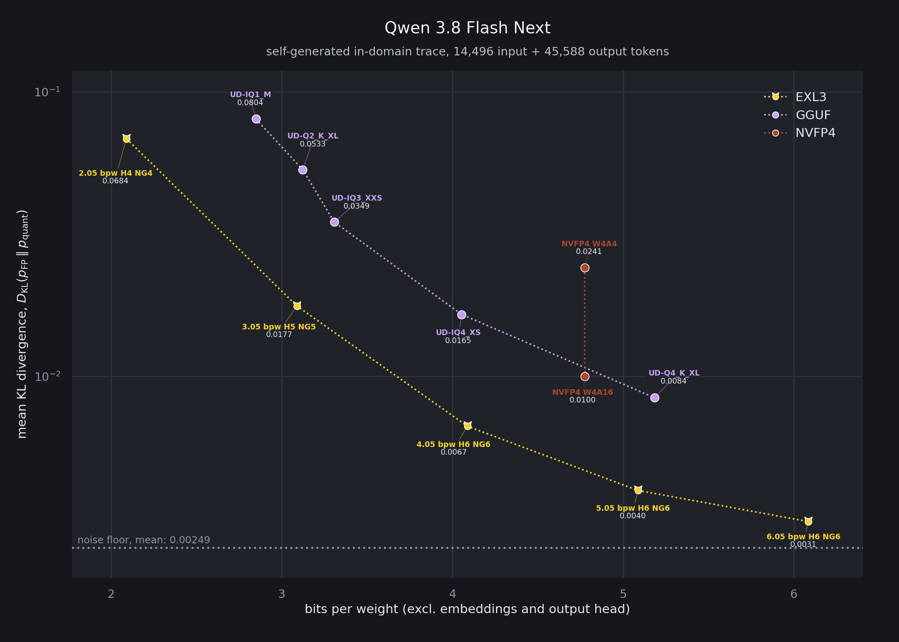

  

    <h1>MemTensor / MemT-1.0-Nano</h1>
    
ASSEMBLED BY: UnstableLlama

  

  

    
Information

    

      exl3 builds of the <b><a class="link-style" href="https://huggingface.co/MemTensor/MemT-1.0-Nano">MemT-1.0-Nano</a></b>
      &#9888;&#65039; <b>PERSISTENT MEMORY MODEL</b> &#9888;&#65039; that works with TabbyAPI.
      ExLlamaV3 fork <b><a class="link-style" href="https://github.com/UnstableLlama/exl3-qlora">exl3-qlora</a></b> required.
        
      MemT-1.0-Nano is Qwen3.6-35B-A3B plus a trained memory block on its ten full-attention layers: the model files earlier
      conversation turns into a 40 MiB latent memory and answers from it instead of re-reading the whole chat.
        
      Each revision is the stock backbone quant from
      <a class="link-style" href="https://huggingface.co/yeasah/Qwen3.6-35B-A3B-exl3">yeasah/Qwen3.6-35B-A3B-exl3</a> (byte for byte, credit yeasah) plus the MemT
      files: <code>memt_block.safetensors</code> (bf16, 0.84 GiB), the MemT configs, and the release chat template with a small
      addition for client-side memory control. No requant.
    

  

  

    
Repo Data

    

      
      
      

        <table class="data-table">
          <thead>
            <tr>
              <th>REVISION</th>
              <th>GiB</th>
              <th>KL DIV</th>
              <th>PPL</th>
              <th>BACKBONE QUANT</th>
            </tr>
          </thead>
          <tbody>
            <tr>
              <td><a class="link-style" href="https://huggingface.co/UnstableLlama/MemT-1.0-Nano-exl3/tree/3.00bpw">3.00bpw</a></td>
              <td>15.67</td>
              <td>0.0215</td>
              <td>1.3389</td>
              <td><a class="link-style" href="https://huggingface.co/yeasah/Qwen3.6-35B-A3B-exl3/tree/3.00bpw-H5">3.00bpw-H5</a></td>
            </tr>
            <tr>
              <td><a class="link-style" href="https://huggingface.co/UnstableLlama/MemT-1.0-Nano-exl3/tree/4.00bpw">4.00bpw</a></td>
              <td>19.64</td>
              <td>0.0069</td>
              <td>1.3207</td>
              <td><a class="link-style" href="https://huggingface.co/yeasah/Qwen3.6-35B-A3B-exl3/tree/4.00bpw">4.00bpw</a></td>
            </tr>
            <tr>
              <td><a class="link-style" href="https://huggingface.co/UnstableLlama/MemT-1.0-Nano-exl3/tree/5.00bpw">5.00bpw</a></td>
              <td>23.55</td>
              <td>0.0030</td>
              <td>1.3150</td>
              <td><a class="link-style" href="https://huggingface.co/yeasah/Qwen3.6-35B-A3B-exl3/tree/5.00bpw">5.00bpw</a></td>
            </tr>
            <tr>
              <td><a class="link-style" href="https://huggingface.co/UnstableLlama/MemT-1.0-Nano-exl3/tree/6.00bpw">6.00bpw</a></td>
              <td>27.47</td>
              <td>0.0018</td>
              <td>1.3116</td>
              <td><a class="link-style" href="https://huggingface.co/yeasah/Qwen3.6-35B-A3B-exl3/tree/6.00bpw">6.00bpw</a></td>
            </tr>
            <tr>
              <td><a class="link-style" href="https://huggingface.co/MemTensor/MemT-1.0-Nano">bf16</a></td>
              <td>63.61</td>
              <td>0.0000</td>
              <td>1.3126</td>
              <td>-</td>
            </tr>
          </tbody>
        </table>
      

    

  

  

    
Usage

    

      Install the fork into TabbyAPI's venv and launch Tabby on a revision. Memory is on by default for this model.
      
EXL3_MEMT_SNAPSHOT_DIR=./memt_snapshots ./venv/bin/python main.py --model-name ./MemT-1.0-Nano-exl3-3.00bpw \
  --draft-mode disabled --max-seq-len 32768 --cache-size 32768 --gpu-split 20 23 \
  --tool-format auto --reasoning-start-token "&lt;think&gt;" --reasoning-end-token "&lt;/think&gt;"

       
      Chat normally. Type <code>/commit</code> to memorize the conversation so far (the prompt the model reads shrinks to what came
      after), or <code>/commit every 3</code> to let it memorize on its own. Edits roll memory back, regenerations don't memorize
      twice, chats don't share memory. Every setting, the request-level controls and the test scripts are in the fork's
      <a class="link-style" href="https://github.com/UnstableLlama/exl3-qlora/blob/master/doc/MEMT_README.md">doc/MEMT_README.md</a>.
        
      Not yet measured: whether memorizing replies as the model generated them (reasoning included, the original
      MemT runtime's way, <code>EXL3_MEMT_COMMIT_GENERATED=1</code>) recalls better than memorizing the client's
      re-sent copy (the default). Both are supported; nobody has compared them.
    

  

  

    
CLI Download

    

      
hf download UnstableLlama/MemT-1.0-Nano-exl3 --revision "3.00bpw" --local-dir ./MemT-1.0-Nano-exl3-3.00bpw

    

  

